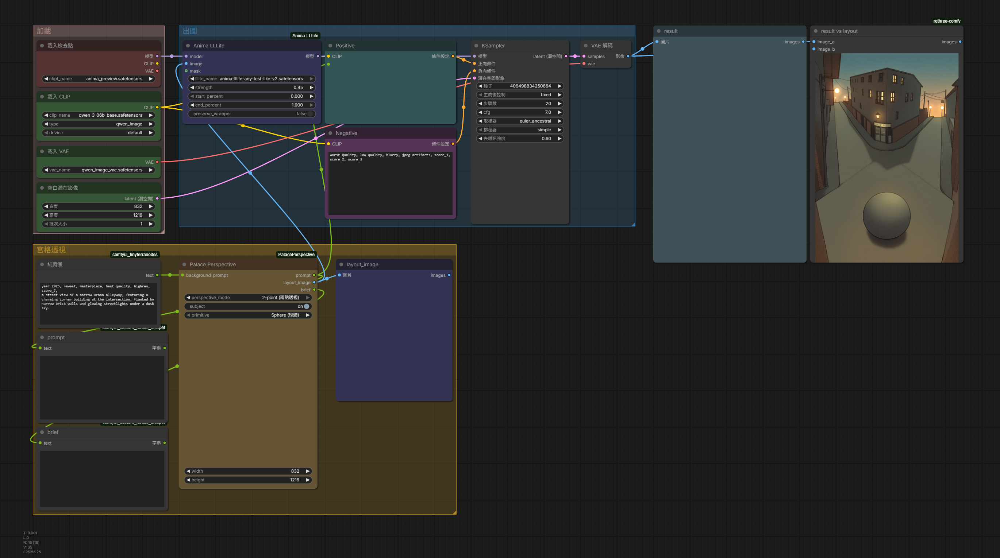

# Palace Perspective

ComfyUI node: a **9×9 palace** plus **1-point / 2-point vanishing rays**. It writes a short prompt and a filled layout image for spatial ControlNet / LLLite.

ComfyUI 節點：用 **9×9 宮格** 與 **一點／兩點透視射線**，產出短提示詞與填色 layout 圖，給空間 ControlNet / LLLite 使用。

Menu: `conditioning / palace_perspective`

Drag `examples/workflow.png` into ComfyUI to load the graph.  
將 `examples/workflow.png` 拖進 ComfyUI 即可載入工作流。

---

## Features / 功能

- **Prompt** — background as-is, then a perspective line from the vanishing point(s), then an occupancy line if subject is on.  
  **組句** — 背景原文 + 透視句（由消失點／地平線寫出）+ 主體開啟時的佔位句。

- **Subject toggle** — on: place a sphere / box / cylinder on the grid and append occupancy; off: perspective ground only.  
  **主體開關** — 開：在宮格上放球體／方體／圓柱並寫佔位；關：只畫透視地面。

- **9×9 palace** — drag a rectangle of cells; Ctrl/Cmd-click to add or remove.  
  **9×9 宮格** — 拖曳選格；Ctrl/Cmd 點選可加或減。

- **1-point camera** — one vanishing point and two rotatable rays; ground is the fan that contains the bottom-center of the frame.  
  **一點透視** — 一個消失點與兩條可旋轉射線；地面是包含畫面底邊中點的扇形。

- **2-point camera** — two vanishing points on one horizon, cyan and magenta ray pairs; ground is the overlap of the two fans, clipped below the horizon.  
  **兩點透視** — 兩個消失點鎖在同一地平線，青／洋紅各一對射線；地面是兩扇重疊區，並裁在地平線以下。

- **Off-frame vanishing points** — the canvas keeps a 50% margin so a VP can sit outside the picture.  
  **畫外消失點** — 畫布四周留 50% 邊距，消失點可落在畫面外。

- **Filled layout** — inverse-depth ground (near white, far gray), dark sky, solid occupancy; no grid or ray strokes in the output image.  
  **填色 layout** — 地面近白遠灰、天空暗、佔位實心；輸出圖不含宮格線或射線。

- **Outputs** — `prompt` (string), `layout_image` (image), `brief` (JSON).  
  **輸出** — `prompt`（字串）、`layout_image`（圖）、`brief`（JSON）。
